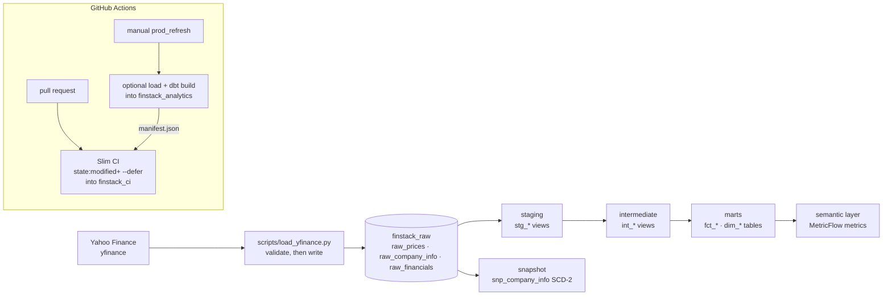

# FinStack Analytics

A small stock-market warehouse on BigQuery, built with dbt. It covers 30 S&P 500 tickers with 5 years of daily adjusted prices and the quarterly income statements Yahoo Finance exposes. A Python loader pulls the data from Yahoo Finance into a raw dataset. dbt then models it into tested facts and dimensions, and a MetricFlow semantic layer defines the metrics on top.

## Architecture



Datasets: raw data stays in `finstack_raw`. dbt builds into `finstack_dev`, `finstack_ci` or `finstack_analytics` depending on the target. Snapshots go to `<target dataset>_snapshots`.

## Data model

| Mart | Grain | Rows* |
|---|---|---|
| `fct_prices_daily` | one row per ticker per trading date (OHLCV, daily return, 20/50-day SMA) | 37,620 |
| `fct_returns` | one row per ticker per month (low, high, volume, close-to-close return) | 1,830 |
| `fct_financials_quarterly` | one row per ticker per fiscal quarter (revenue, profit, QoQ growth, margins) | 183 |
| `dim_companies` | one row per ticker | 30 |
| `dim_sectors` | one row per sector | 7 |
| `snp_company_info` (snapshot) | one row per ticker per version of sector / industry / analyst rating | 30 |

\* From the CI build on 2026-10-22 against raw data last loaded on 2026-09-04 (prices from 2021-09-07 to 2026-09-03). The build ran 13 nodes and 19 tests: 32 passed, 0 warned, 0 failed.

## Design decisions

**Adjusted prices, and a full rebuild instead of incremental.** The loader asks yfinance for split- and dividend-adjusted prices (`auto_adjust=True`). Without adjustment, NVDA's 10:1 split in June 2024 would show up as a 90% one-day crash. The catch is that adjusted history gets restated every time a split or dividend happens, so an incremental model that only appends new dates would end up mixing old and new adjustment factors. At about 38k rows, rebuilding `fct_prices_daily` in full is cheap and always consistent. At a much larger scale I would store unadjusted prices plus a corporate-actions table, and apply the adjustment in dbt. Then an incremental model would be safe.

**Financials accumulate.** Yahoo only exposes the most recent 5–7 quarters per company, so a truncate-and-reload would lose history over time. The loader appends each fetch with a `_loaded_at` timestamp, and `stg_financials` keeps the latest version of each `(ticker, quarter_date)` that has revenue. The revenue condition matters because Yahoo often returns the oldest quarter of a fetch with every value null.

**SCD-2 snapshot without market cap.** `snp_company_info` records a new version when a company's sector, industry or analyst recommendation changes. `market_cap` is excluded because it moves every day and would turn the snapshot into a price log.

**Ratio metrics, not averaged percentages.** `gross_margin` and `net_margin` are MetricFlow ratio metrics, `sum(numerator) / sum(revenue)`, returned as fractions (0.68 = 68%), so a sector or a year is weighted by revenue. They are never an average of per-quarter percentages. Banks and insurers have no gross profit in Yahoo's data, so their revenue is left out of the gross-margin denominator rather than diluting it. The trade-off is that the Financial Services gross margin reflects Visa only, the one company in that sector that reports gross profit.

**A contract on the main fact.** `fct_prices_daily` has an enforced dbt contract: column names, types and not-null constraints. A change that breaks its shape fails the build instead of silently changing what consumers see.

**Vendor sector classification.** Sectors come from Yahoo Finance, not official GICS. For example, GOOGL and META are "Communication Services", so the 30 tickers fall into 7 sectors. The docs say so instead of pretending it is GICS.

## Data quality

- Grain uniqueness on every mart, on `stg_prices` and `stg_financials` (the deduplicated one), and on the snapshot's `(ticker, dbt_valid_from)`.
- Surrogate keys (`price_id`, `financials_id`) are unique and not null.
- Referential integrity: every price and financial row has a ticker in `dim_companies`.
- Range checks: close price, volume and market cap are never negative.
- A singular test checks that every daily bar satisfies `low ≤ open ≤ high` and `low ≤ close ≤ high`.
- Source freshness warns after 7 days. It never errors, because loading is manual.
- The loader validates before it writes: if fewer than 30 tickers come back, or columns are missing, nothing is written. A partial fetch never overwrites a good table.

## CI/CD

- **Slim CI** (`dbt_slim_ci.yml`) runs on every pull request. It downloads the manifest from the last prod run and builds only `state:modified+` into `finstack_ci`, deferring unchanged parents to prod. If no prod manifest exists yet, it runs a full build.
- **Prod refresh** (`prod_refresh.yml`) is manual only. It optionally runs the loader, checks freshness, builds prod and uploads the manifest for Slim CI. It is not on a schedule because Yahoo can rate-limit GitHub runner IPs. When that happens, run the loader locally and start the workflow with `load_data` unticked.

## Run it locally

```bash
python3.12 -m venv .venv && source .venv/bin/activate
pip install -r requirements.txt

# A service account key with BigQuery access, kept out of git:
#   credentials/service_account.json
export GCP_PROJECT_ID=finstack-analytics   # default
export DBT_TARGET=dev                      # dev | ci | prod; default dev

python scripts/load_yfinance.py --dry-run  # fetch + validate, writes nothing

cd finstack_dbt
dbt deps
dbt build                                  # into finstack_dev and finstack_dev_snapshots
mf query --metrics revenue,gross_margin --group-by metric_time__quarter,company__sector
```

To load real data without touching the prod raw dataset, run `RAW_DATASET=finstack_raw_dev python scripts/load_yfinance.py`, then build against it with `dbt build --vars '{raw_dataset: finstack_raw_dev}'`.

## Limitations and what changes at scale

- Yahoo Finance is an unofficial source. It has no SLA, rate-limits aggressively, and its fields can change without notice. A production version would use a licensed market-data feed.
- Sector-quarter totals depend on which companies Yahoo returned for that quarter. The oldest and newest quarters are often incomplete, so compare sectors only where all their companies reported.
- Fundamentals history only starts from the first load. Earlier quarters are not backfilled.
- Prices are fully rebuilt on every run. That's fine at 30 tickers. At thousands of tickers I would store unadjusted prices plus corporate actions and go incremental.
- CI shares one `finstack_ci` dataset, so two PRs running at the same time can overwrite each other's tables. Per-PR datasets would fix that.
- CI and prod authenticate with a long-lived service-account key stored as a GitHub secret. Workload Identity Federation would remove that key.
